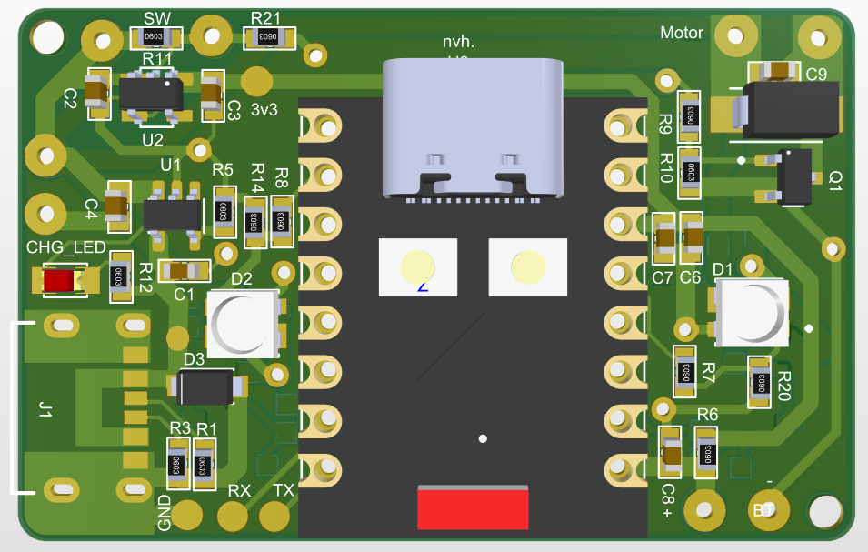
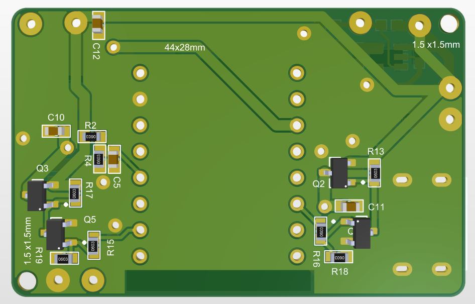

# Smart Couple Coin

Cặp móc khóa kết nối dành cho những người ở xa nhau. Ý tưởng của dự án là khi một người bấm nút, thiết bị của người còn lại sẽ nháy đèn RGB và rung để báo có một lời nhắn đang được gửi đến.

Mỗi thiết bị sử dụng ESP32-C3 SuperMini, hai LED RGB, motor rung và pin Li-Po sạc qua USB-C. Repository này lưu đặc tả sản phẩm, tài liệu phần cứng, file sản xuất PCB, thiết kế vỏ và kế hoạch phát triển firmware.

> **Trạng thái hiện tại:** đã hoàn thành thiết kế mạch và hàn mạch. Chưa có firmware; chức năng gửi/nhận và thời lượng pin chưa được kiểm chứng. Các tính năng bên dưới là mục tiêu phát triển.

## Tiến độ

| Hạng mục | Trạng thái |
| --- | --- |
| Đặc tả sản phẩm | Đã có tài liệu cho prototype |
| Thiết kế mạch và xuất Gerber | Hoàn thành |
| Hàn mạch | Hoàn thành |
| Thiết kế vỏ | Đã có file FreeCAD và STEP; cần kiểm tra lắp thực tế |
| Kiểm thử phần cứng sau hàn | Chưa có kết quả kiểm thử được ghi nhận trong repo |
| Firmware | Chưa triển khai |
| Kiểm thử hai thiết bị gửi/nhận | Chưa thực hiện |

## Hình ảnh PCB

Đây là ảnh dựng 3D của PCB, dùng để tham khảo bố trí linh kiện.

| Mặt trên | Mặt dưới |
| --- | --- |
|  |  |

[Xem sơ đồ nguyên lý PDF](hardware/schematic.pdf) · [Xem ảnh sơ đồ nguyên lý](hardware/image/schematic.png)

## Chức năng dự kiến

- Bấm nút trên một thiết bị để gửi tín hiệu tới thiết bị còn lại qua Internet.
- Khi nhận tín hiệu, hai LED RGB nháy trong khoảng 3 giây và motor rung trong khoảng 1 giây.
- Kết nối Wi-Fi và trao đổi tín hiệu qua MQTT; HiveMQ Cloud là broker dự kiến cho prototype.
- Cấu hình Wi-Fi và màu LED bằng trang web do thiết bị phát ra trong chế độ cấu hình.
- Sử dụng deep sleep và thức dậy định kỳ để kiểm tra tín hiệu: mỗi 5 phút từ 07:00–23:00, mỗi 30 phút từ 23:00–07:00, theo lịch UTC+7 trong đặc tả.
- Đo điện áp pin, báo pin yếu, hỗ trợ khôi phục cấu hình và cập nhật firmware qua Wi-Fi (OTA).

Thiết kế hiện tại dùng cơ chế kiểm tra tín hiệu định kỳ, nên thiết bị nhận có thể phải chờ tới lần thức dậy tiếp theo. Mục tiêu pin từ 5 ngày trở lên là yêu cầu thiết kế, chưa phải kết quả đo.

## Phần cứng

Thông tin dưới đây tóm tắt thiết kế trong tài liệu; giá trị linh kiện đã hàn cần được đối chiếu khi kiểm thử.

| Khối | Thiết kế |
| --- | --- |
| Vi điều khiển | ESP32-C3 SuperMini |
| Hiển thị | 2 LED RGB SK6812MINI-012 |
| Phản hồi | Motor rung coin 3 V |
| Nguồn pin | Li-Po 1 cell, 3,7 V; dung lượng mục tiêu 220 mAh |
| Sạc | LTC4054, đầu vào USB-C; dòng sạc thiết kế khoảng 140–150 mA |
| Nguồn logic | AP2112K-3.3 |
| Điều khiển | 1 nút bấm và 1 công tắc nguồn ngoài |
| PCB | 44 × 28 mm, 2 lớp |
| Vỏ | Kích thước mục tiêu 50 × 35 × 18 mm; file thiết kế cho in 3D |

Cổng USB-C trên PCB chính dùng để sạc. Phương án nạp firmware ban đầu sẽ được xác nhận khi đưa mạch vào hoạt động, dựa trên cổng USB của module hoặc các test pad UART/BOOT hiện có.

### GPIO tham chiếu

| GPIO | Tín hiệu | Chức năng |
| --- | --- | --- |
| 0 | `GPIO_BT` | Nút bấm, nhấn ở mức LOW |
| 1 | `SW_LED1` | Bật nguồn LED 1 |
| 3 | `ADC_BAT` | Đo điện áp pin qua cầu chia áp VBAT/2 |
| 4 | `LED1` | Dữ liệu LED 1 |
| 6 | `LED2` | Dữ liệu LED 2 |
| 7 | `MOTOR` | Điều khiển motor rung |
| 10 | `SW_LED2` | Bật nguồn LED 2 |
| 20 / 21 | `RXD0` / `TXD0` | UART nạp và debug |

Xem [phân bổ I/O và các khối mạch](hardware/hardware.md), [BOM](hardware/bom.md) và [đặc tả sản phẩm](spec/spec.md) để biết chi tiết.

## Cấu trúc repository

```text
smart-couple-coin/
├── README.md
├── docs/
│   ├── assembly-and-testing.md    # Quy trình hàn và kế hoạch kiểm thử
│   ├── firmware-plan.md           # Lộ trình firmware, ví dụ code tham khảo
│   └── spec-review.md             # Lịch sử rà soát đặc tả
├── spec/
│   ├── spec.md                    # Đặc tả sản phẩm và yêu cầu firmware
│   └── question.md                # Câu hỏi và quyết định thiết kế ban đầu
├── hardware/
│   ├── hardware.md                # GPIO và các khối chức năng
│   ├── bom.md                     # Danh sách linh kiện
│   ├── schematic.pdf              # Sơ đồ nguyên lý
│   ├── image/                     # Ảnh PCB và schematic
│   ├── gerbers/                   # Gói file sản xuất PCB
│   ├── pcb/                       # Mô hình PCB: FreeCAD và STEP
│   └── enclosure/                 # Vỏ: FreeCAD, STEP và yêu cầu cơ khí
└── firmware/
    └── README.md                  # Trạng thái và bước triển khai tiếp theo
```

## Bắt đầu với project

Tải repository:

```sh
git clone https://github.com/hoang1302/smart-couple-coin.git
cd smart-couple-coin
```

1. Đọc [đặc tả sản phẩm](spec/spec.md) để hiểu hành vi dự kiến của hai thiết bị.
2. Xem [schematic](hardware/schematic.pdf), [BOM](hardware/bom.md) và [GPIO](hardware/hardware.md) để đối chiếu mạch đã hàn.
3. Dùng [quy trình hàn và kiểm thử](docs/assembly-and-testing.md) làm tài liệu tham khảo khi kiểm tra mạch.
4. Xem [trạng thái firmware](firmware/README.md) và [kế hoạch phát triển](docs/firmware-plan.md) trước khi bắt đầu lập trình.

### File thiết kế và sản xuất

- [Gerber PCB](hardware/gerbers/smart-couple-coin-gerbers.zip): gói Gerber và drill đã xuất.
- [PCB FreeCAD](hardware/pcb/pcb_centered.FCStd) · [PCB STEP](hardware/pcb/pcb_centered.step): mô hình 3D tham chiếu cho lắp ráp và thiết kế vỏ.
- [Vỏ FreeCAD](hardware/enclosure/CoinCase.FCStd): file thiết kế vỏ có thể chỉnh sửa.
- [Vỏ STEP](hardware/enclosure/CoinCase_generated.step) · [Thân dưới](hardware/enclosure/CoinCase_BottomShell.step) · [Nắp trên](hardware/enclosure/CoinCase_TopLid.step): các bản xuất cơ khí.
- [Yêu cầu cơ khí](hardware/enclosure/requirements.md) · [Ghi chú thiết kế vỏ](hardware/enclosure/design-notes.txt): kích thước, bố trí và các giả định của thiết kế hiện tại.

Repo hiện chưa có file nguồn EDA để chỉnh sửa schematic/layout PCB. File FreeCAD/STEP của PCB là mô hình cơ khí tham chiếu; cần bổ sung project EDA gốc khi có.

## Lộ trình tiếp theo

- [ ] Kiểm tra mối hàn, thông mạch, nguồn 3V3 và mạch sạc; ghi lại kết quả thực đo.
- [ ] Xác nhận BOM theo linh kiện thực tế, nhất là điện trở kéo nút bấm và các giá trị còn khác nhau giữa tài liệu.
- [ ] Tạo project firmware và xác nhận nạp/debug trên ESP32-C3.
- [ ] Kiểm thử riêng nút bấm, từng LED, motor và ADC pin.
- [ ] Kiểm thử deep sleep, thức dậy bằng nút bấm và timer.
- [ ] Triển khai Wi-Fi, MQTT và thử gửi/nhận với hai thiết bị.
- [ ] Bổ sung trang cấu hình, xử lý lỗi và OTA.
- [ ] Đo dòng tiêu thụ, thời lượng pin và kiểm tra lắp vỏ thực tế.

Các đoạn code và bảng kiểm trong `docs/` là tài liệu lập kế hoạch, chưa phải firmware chạy được hoặc báo cáo kiểm thử đã hoàn thành.

## Giấy phép

Dự án chưa lựa chọn giấy phép sử dụng. Repository hiện chưa có file `LICENSE`.
